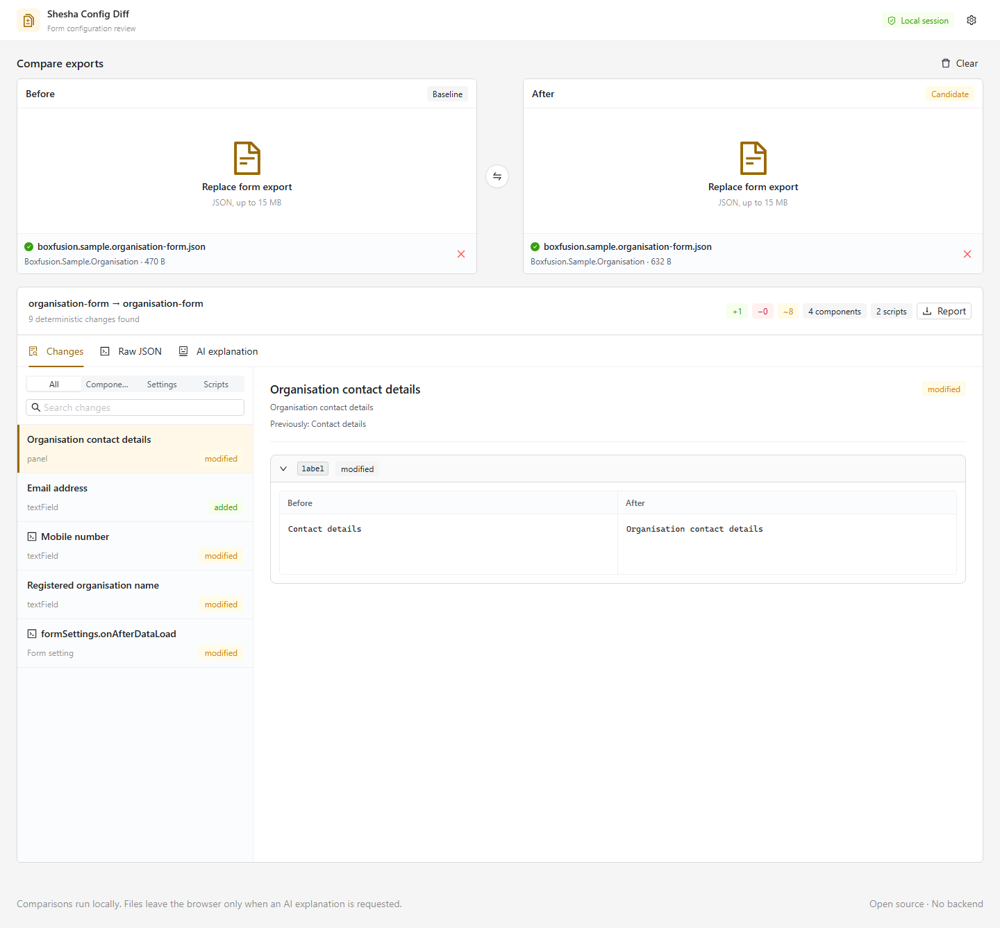

# Shesha Config Diff

A local-first visual comparison tool for exported [Shesha](https://github.com/shesha-io/shesha-framework) form configurations.



## What It Does

- Compares two exported Shesha form JSON files in the browser.
- Matches nested components primarily by stable Shesha component ID.
- Separates component, form-setting, script, expression, and ordering changes.
- Ignores object-key ordering while preserving meaningful array ordering.
- Switches between Side by Side and Inline views for settings, scripts, validators, and dynamic expressions, with additions and removals highlighted.
- Exports a deterministic Markdown report for reviews and pull requests.
- Optionally asks a user-selected AI provider to explain the computed diff.

The deterministic comparison is always the source of truth. AI is an optional explanation layer and does not decide whether two exports differ.

## Privacy Model

There is no application backend.

- Form parsing and comparison run entirely in the browser.
- Uploaded files are not persisted and are cleared when the page is closed or refreshed.
- Only non-secret AI preferences (provider, model, and endpoint) are saved in browser local storage.
- The API key stays in memory only. Refreshing or closing the page forgets it; **Clear key** removes it from the active settings without resetting saved preferences.
- An AI request is made only when the user selects **Explain diff**.
- Only the computed diff is sent. Likely credentials and tokens are redacted first; raw form exports are not sent.

Memory-only storage reduces persistent exposure; it does not hide the key from page scripts, privileged browser extensions, device malware, or browser request inspection while it is in use. Use a trusted device and browser, and send keys only to trusted HTTPS provider endpoints. Use a dedicated, restricted key and provider-supported usage controls. If a key may have been exposed, revoke or rotate it with the provider; clearing it here does not revoke it.

A provider may also reject direct browser requests because of its CORS policy. Do not route keys through an untrusted proxy to bypass that restriction. See [SECURITY.md](SECURITY.md) for further precautions.

## Supported Export Shape

The current comparer expects the standard Shesha form export structure:

```json
{
  "components": [],
  "formSettings": {}
}
```

Files with duplicate or missing component IDs are accepted with warnings. Components without IDs fall back to location-based matching, which is less reliable after large structural edits.

Component discovery includes direct children, wizard steps, tabs, columns, and panel header/content slots. Child changes are listed individually; parent comparisons retain the container settings without duplicating its child definitions.

Scripts inside action/configuration arrays have their own diffs under the owning component. Configured items, buttons, and actions are grouped by their names, with changed settings and scripts nested underneath. Wizard steps show their number and configured title (falling back to label, name, or just the number). Numbers use the After order, or the Before order for removed steps. Array items are matched by ID or key where available (otherwise by position); ordering changes are shown separately. Exact configuration paths remain available on hover and in exported reports.

Table entries also use column captions, dialog titles, bound property names, or action names when a button label is unavailable.

## Local Development

Prerequisites:

- Node.js 24 or later
- npm 11 or later

```bash
npm install
npm run dev
```

Quality checks:

```bash
npm run lint
npm run type-check
npm test
npm run build
npm run test:e2e
```

## AI Providers

The settings drawer supports:

- OpenAI Responses API
- Anthropic Messages API
- Google Gemini `generateContent`
- OpenAI-compatible chat-completions endpoints

Model names are deliberately entered by the user instead of being hard-coded, because account access and available models change independently of this application.

## GitHub Pages

The Vite build uses relative asset paths and can be hosted from a project subdirectory. The included workflow publishes `dist` to GitHub Pages after a successful push to `main`.

Enable **GitHub Actions** as the Pages source in the repository settings after the repository is created.

## Project Structure

```text
src/
  components/       UI components
  constants/        App, provider, and theme configuration
  hooks/            Reusable React hooks
  styles/           Shared Ant Design styles
  types/            Domain and transport types
  utils/
    ai/              Provider adapters and redaction
    diff/            Deterministic comparison engine
    files/           Export parsing and validation
    forms/           Shared component structure discovery
    report/          Local Markdown report generation
tests/               Unit tests for comparison behavior
e2e/                 Browser workflow tests
```

## Contributing

See [CONTRIBUTING.md](CONTRIBUTING.md). The project follows the functional TypeScript and Ant Design conventions used by the Shesha frontend, with feature branches and pull-request-based changes.

## License

Licensed under the [Apache License 2.0](LICENSE.md).
